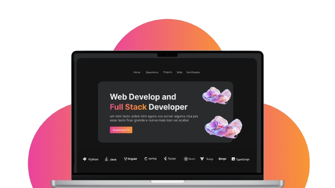

   <h1>My Portfolio</h1>
    

   <h3>🚧 Building his Project</h3>
    
    
  
A high-performance portfolio built with modern Angular practices, showcasing professional work and technical capabilities through clean design and efficient architecture.

   
  

 

### Key Features

- **Modular Architecture**: Feature-based organization with lazy loading
- **Optimized Performance**: OnPush change detection, lightweight animations
- **Global Ready**: Multi-language support (i18n) with dynamic content loading
- **Adaptive UI**: Responsive layouts using CSS Grid/Flex with mobile-first approach
- **Developer Experience**: Strict typing, reusable components, and comprehensive docs

 

### Languages & tools
 
A high-performance portfolio built with modern Angular practices, showcasing professional work and technical capabilities.

 

### Development server

- To start a local development server, run `ng serve`.  
- Once the server is running, open your browser and navigate to `http://localhost:4200/`.  
- The application will automatically reload whenever you modify any of the source files. To build the project run `ng build`. 

 

##
 

  This project was generated by Angular version 19.2.15.
By Me.

